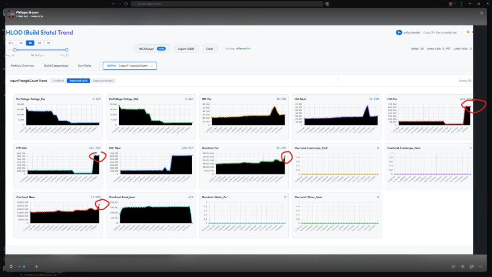
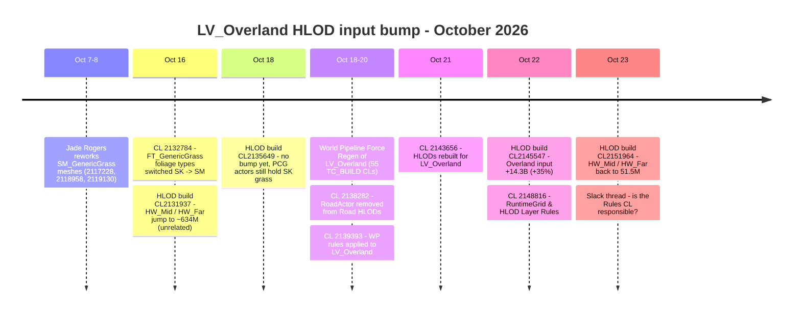
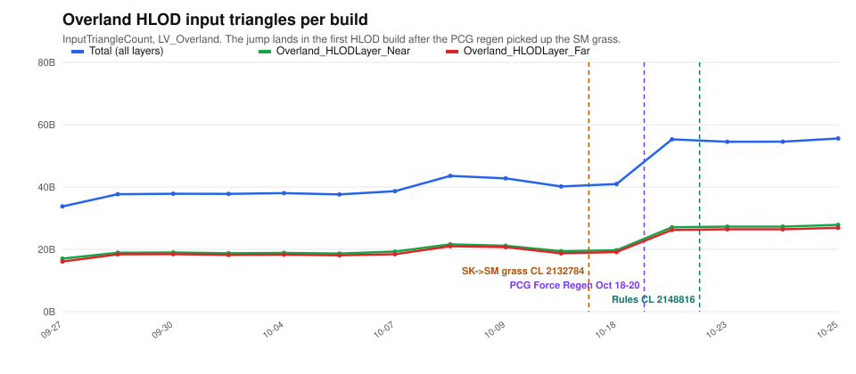
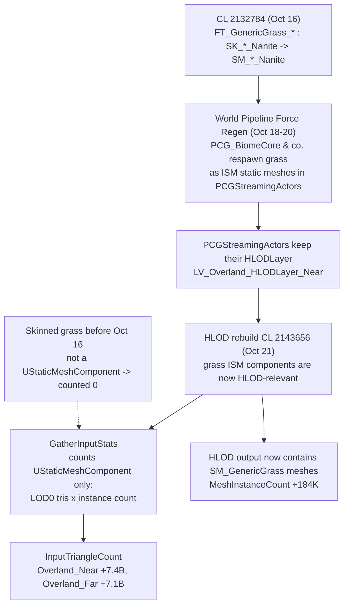
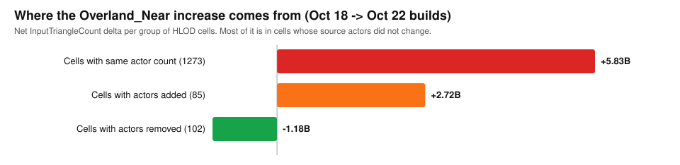
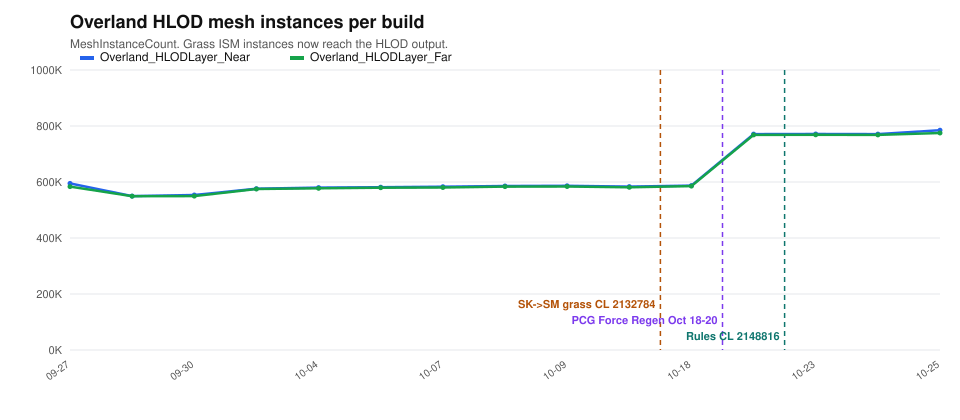
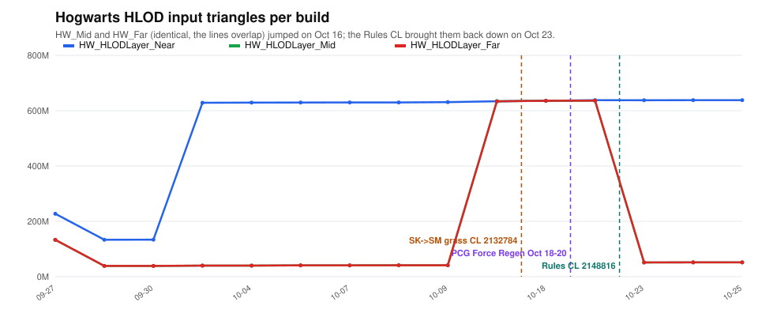
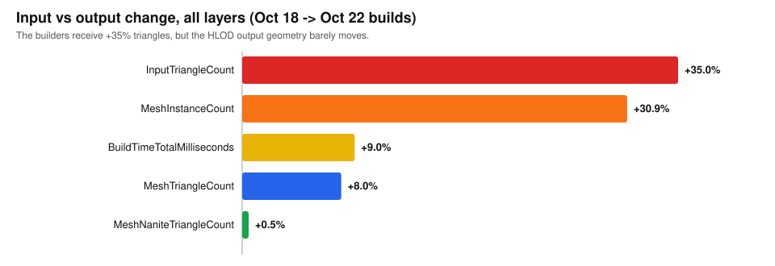
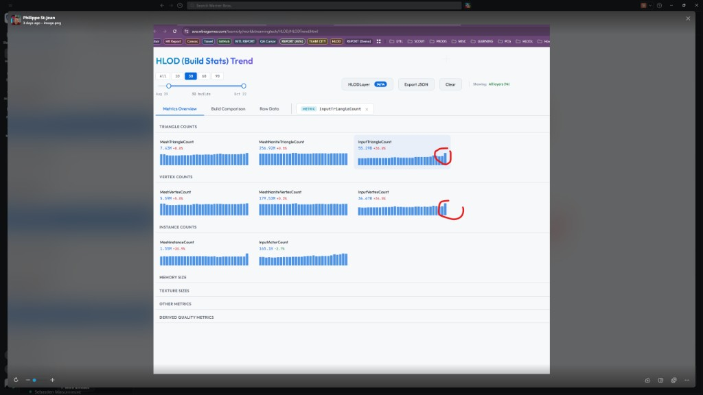

Parent: [Audits](README.md)

# HLOD input triangle bump on `LV_Overland` - root cause (2026-10-26)

On Friday October 23 the [HLOD Build Stats Trend](https://ava.wbiegames.com/teamcity/worldstreamingtech/HLOD/HLODTrend.html)
dashboard showed `InputTriangleCount` up **+35.9%** and `InputVertexCount` up **+34%** on
`LV_Overland`. The obvious suspect was the RuntimeGrid & HLOD Layer Rules change landed the
day before (CL 2148816, robomerged to Dev-Engine as CL 2151306).

**It is not the Rules change.** The exact cause is the **skeletal-to-static grass conversion**
of CL 2132784 (*"Removing Skeletal mesh grass Grass types replaced with SM Version"*,
SUNDANCE-77409), propagated across the whole Overland by the World Pipeline PCG
*Force Regen* of October 18-20. The HLOD input stats only count static mesh
components, so the grass went from **invisible** to the HLOD stats (and to the HLOD builders)
to **fully counted, LOD0 triangles x instance count**, overnight.



*The dashboard as shared on Slack on Oct 23. The circled jumps on HW:Mid / HW:Far and
Overland:Near / Overland:Far are two different events - see [Timeline](#timeline).*

## Contents

- [TL;DR](#tldr)
- [Timeline](#timeline)
- [Causal chain](#causal-chain)
- [Evidence](#evidence)
  - [1. The bump is in Overland, not in the layers the Rules touched](#1-the-bump-is-in-overland-not-in-the-layers-the-rules-touched)
  - [2. Same actors, heavier content](#2-same-actors-heavier-content)
  - [3. One cell, one actor: SK grass out, SM grass in](#3-one-cell-one-actor-sk-grass-out-sm-grass-in)
  - [4. The grass now reaches the HLOD output](#4-the-grass-now-reaches-the-hlod-output)
  - [5. Why skeletal grass was never counted](#5-why-skeletal-grass-was-never-counted)
  - [6. It is the same pattern across the PCG actors](#6-it-is-the-same-pattern-across-the-pcg-actors)
- [What the Rules change actually did](#what-the-rules-change-actually-did)
- [Impact](#impact)
- [What was checked and ruled out](#what-was-checked-and-ruled-out)
- [Open questions and recommendations](#open-questions-and-recommendations)
- [How this audit was run](#how-this-audit-was-run)

## TL;DR

| Question | Answer |
|---|---|
| What jumped? | `Overland_HLODLayer_Near` **+7.4B** and `Overland_HLODLayer_Far` **+7.1B** input triangles, between the Oct 18 and Oct 22 HLOD builds |
| Exact cause | CL **2132784** (Oct 16) switched the 12 `FT_GenericGrass_*` foliage types from `SK_GenericGrass_*_Nanite` (skinned Nanite assemblies) to `SM_GenericGrass_*_Nanite` (static meshes) |
| Why it showed up on Oct 22 | The PCG actors only picked the new grass up when the World Pipeline *Force Regen* rewrote them (55 `TC_BUILD_*` CLs, Oct 18-20); the next HLOD rebuild (CL 2143656, Oct 21) baked it |
| Why it is so large | `GatherInputStats` counts `UStaticMeshComponent` only. Skinned grass counted **0**; SM grass counts LOD0 triangles x instances |
| Rules CL 2148816? | Not involved in the Overland bump. It **fixed** HW_Mid / HW_Far, which had jumped on Oct 16 (~636M -> 51.5M) |
| Is it bad? | Output geometry barely moves (`MeshTriangleCount` +8%, Nanite +0.5%), but grass is now **baked into Overland HLODs** (+184K instances) and the builders process +35% input |

## Timeline





The grass CL lands before the Oct 18 build, yet that build shows nothing: the PCG actors had
not been regenerated yet. The jump appears in the first HLOD build **after** the Force Regen.

## Causal chain



## Evidence

### 1. The bump is in Overland, not in the layers the Rules touched

`InputTriangleCount` per layer, from `HLODTrendData.json`:

| HLOD build | Date | Overland_Near | Overland_Far | HW_Near | HW_Mid | HW_Far |
|---|---|---|---|---|---|---|
| CL2121339 | Oct 09 | 21.15B | 20.71B | 630.8M | 41.1M | 41.1M |
| CL2131937 | Oct 16 | 19.39B | 18.73B | 634.1M | **633.9M** | **633.8M** |
| CL2135649 | Oct 18 | 19.73B | 19.15B | 635.8M | 635.8M | 635.7M |
| CL2145547 | Oct 22 | **27.09B** | **26.22B** | 638.0M | 636.4M | 636.3M |
| CL2151964 | Oct 23 | 27.28B | 26.42B | 637.8M | **51.5M** | **51.5M** |
| CL2155477 | Oct 25 | 27.85B | 26.91B | 638.1M | 51.8M | 51.8M |

HLOD build ids are the `//sun/Dev` changelist the build synced. The Overland jump sits between
CL2135649 and CL2145547, **before** CL 2148816. The first build containing CL 2148816
(CL2151964) adds only ~0.2B to Overland.

### 2. Same actors, heavier content

Per-cell comparison of `HLODStats-CL2135649.csv` and `HLODStats-CL2145547.csv` for
`Overland_HLODLayer_Near` (1460 cells, unchanged):



- **+5.83B of the +7.37B** is in cells whose input actor count did not change at all.
- 829 cells gain more than 1M triangles, spread over the whole Overland: this is not a local edit.
- Net change: +243 input actors but **+184K mesh instances**.

Existing actors got heavier. That rules out an HLOD layer reassignment (it would move actors
between layers) and points at actors whose *content* was regenerated.

### 3. One cell, one actor: SK grass out, SM grass in

`LV_Overland_HLODLayer_Near/MainGrid_L1_X-3_Y4_Z0` has exactly **one** source actor in both
builds, and its input doubles:

| | Before (CL2135649) | After (CL2145547) |
|---|---|---|
| Input actors | 1 | 1 |
| InputTriangleCount | 94.9M | **190.1M** |
| MeshInstanceCount | 1561 | **2885** |

The HLOD actor package (`A/BB/ZZ0SCU2XBUD4CS1OOHFFYP`) names that source actor:
`3/7E/HVU6BSKAB2W6KZC8DTUHWO`, a `SunPCGBiomeCore.PCGStreamingActor` on
`DL_PROCEDURAL`, with `HLODLayer = LV_Overland_HLODLayer_Near`. Its Perforce history:

| Rev | CL | Date | By |
|---|---|---|---|
| #33 | 2117016 | Oct 07 | TeamCity World Pipeline (state seen by the Oct 18 HLOD build) |
| #34 | 2137506 | Oct 18 | TeamCity World Pipeline - Force Regen |
| #35 | 2139347 | Oct 19 | TeamCity World Pipeline - Force Regen (state seen by the Oct 22 HLOD build) |

Package size goes **6.6 MB -> 9.6 MB** (+45%). Asset references #33 -> #35:

| Removed | Added |
|---|---|
| `SK_GenericGrass_Large_A_Nanite` | `SM_GenericGrass_Small_Bend_A_Nanite` |
| `SK_GenericGrass_Medium_A_Nanite` | `SM_GenericGrass_Small_Bend_B_Nanite` |
| `SK_GenericGrass_Medium_B_Nanite` | `SM_GenericGrass_Tall_Bend_A_Nanite` |
| `SK_GenericGrass_Small_A_Nanite` | `MI_GenericGrass_Atlas_3D_Tall` |
| `SK_GenericGrass_Small_Bend_B_Nanite` | `SK_GreatWoodRush_A..E_Nanite` (skinned, not counted) |
| `MI_GenericGrass_Nanite`, `MI_GenericGrass_Tall_Nanite` | `SM_Bank_Road_GravelRoad_A/B/C`, `SM_Mound_4M_A`, `SM_Inset_Road_A_LGStones` |
| `SM_Bank_Road_Stone_A/B/C` | |

The skinned grass assemblies are replaced by their static-mesh versions, exactly what
CL 2132784 describes.

### 4. The grass now reaches the HLOD output

Same comparison on the **HLOD actor** of that cell (`ZZ0SCU2XBUD4CS1OOHFFYP`,
@2135649 vs @2145547): 550 KB -> 770 KB, and these references appear:

- `SM_GenericGrass_Small_Bend_A_Nanite`
- `SM_GenericGrass_Small_Bend_B_Nanite`
- `SM_GenericGrass_Tall_Bend_A_Nanite`
- `MI_GenericGrass_Atlas`, `T_GenericGrass_Atlas_D`, `T_GenericGrass_Atlas_SRO`
- `MI_GreatWoodRush_Atlas` and its textures

No grass mesh was referenced by this HLOD before. Grass instances are now part of the
Overland Near HLODs, which is where the +184K `MeshInstanceCount` comes from.



### 5. Why skeletal grass was never counted

The input stats are computed in `GatherInputStats`
(`Engine/Plugins/Editor/WorldPartitionHLODUtilities/Source/Private/WorldPartition/HLOD/Utilities/WorldPartitionHLODUtilities.cpp`):

```cpp
if (UStaticMeshComponent* SMComponent = Cast<UStaticMeshComponent>(HLODRelevantComponent))
{
    // ...
    const int64 LOD0TriCount = RenderData->LODResources[0].GetNumTriangles();
    const int64 NumInstances = ISMComponent ? ISMComponent->GetInstanceCount() : 1;
    NumTriangles += LOD0TriCount * NumInstances;
}
```

Only static mesh components (including ISM/HISM) contribute. A skinned Nanite assembly
contributes **0**. Converting grass from SK to SM therefore makes every grass instance count
at its full LOD0 triangle count. With grass being the densest instanced content of the biome,
that is billions of triangles.

### 6. It is the same pattern across the PCG actors

Sample of 30 actors written by Force Regen CL 2140021, compared between the two HLOD builds:

| | Count |
|---|---|
| `PCGStreamingActor` sampled | 30 |
| Lost `SK_GenericGrass_*` references | **19** |
| Lost SK grass **and** gained new `SM_GenericGrass_*` names | 6 |
| Gained SM grass only (no SK grass before) | 1 |
| No grass change (empty / tiny streaming actors) | 10 |

In the 13 actors that lost SK grass without gaining a *new* SM name, the SM grass was already
referenced (a mix existed after the Oct 7-8 reimports). Only its instance count grows, which
a reference diff cannot show.

## What the Rules change actually did



HW_Mid and HW_Far jumped on **Oct 16** to the same input as HW_Near (~634M), meaning they were
fed the full HW source set. The first build containing CL 2148816 (Oct 23) brings them back to
**51.5M**, and HW input actors drop from 21.3K to 18.6K. The jump circled on the Oct 23
dashboard screenshot was this older event, seen before the Oct 23 build was loaded.

## Impact



| Totals, all layers | Oct 18 | Oct 22 | Delta |
|---|---|---|---|
| InputTriangleCount | 40.94B | 55.29B | +35% |
| MeshInstanceCount | 1.19M | 1.55M | +31% |
| BuildTimeTotalMilliseconds | 29.2M | 31.9M | +9% |
| MeshTriangleCount | 6.89M | 7.43M | +8% |
| MeshNaniteTriangleCount | 255.6M | 256.9M | +0.5% |



- **Build side:** +35% input for the Overland builders, +9% total build time; a plausible
  contributor to the HLOD workers that failed on Oct 23.
- **Runtime side:** grass instances are now baked into the Overland Near/Far HLODs. Whether
  that is wanted is a content decision (see below).
- **Stats side:** part of the jump is a *measurement* change. The grass existed before; it was
  simply invisible to `InputTriangleCount` while skinned.

## What was checked and ruled out

| Candidate | Verdict |
|---|---|
| Rules CL 2148816 / 2151306 | Lands after the jump; only ~+0.2B on Overland. Fixed HW_Mid / HW_Far |
| Road rules CL 2138282 | Real (Road_Near 572 -> 1 actors), but former road cells hold only 0.94B of the 7.37B |
| WP rules apply CL 2139393 (599 actors) | Layer reassignment moves actors; the bump is in cells with no actor change |
| `Overland_HLODLayer_Dummy` removal | 6.6K actors / 87M triangles - two orders of magnitude too small |
| HLOD code changes in the window | Only CL 2144059 (HLOD Debugger MCP toolset) - no effect on the builders or stats |
| HLOD layer asset changes | None in the window (`DA_Overland_HLODLayer_Road_Near_Rules` and `MM_Landscape_HLOD` only) |

## Open questions and recommendations

1. **Decide whether grass belongs in the Overland HLODs.** If not, exclude it at the source:
   turn off HLOD inclusion on the grass ISM descriptors of the PCG mesh spawners / the
   `FT_GenericGrass_*` foliage types, or add a rule excluding the grass from
   `Overland_HLODLayer_Near`. Owners: environment art (Jade Rogers, SUNDANCE-77409) and
   world streaming (Philippe St-Jean).
2. **Re-baseline the dashboard.** Even if the grass is kept, the Oct 22 build is the new normal;
   comparisons across Oct 20 mix "SK grass invisible" and "SM grass counted".
3. **Check `GreatWoodRush`.** It is still a skinned assembly (`SK_GreatWoodRush_*`); converting
   it later will cause the same kind of jump.
4. **Check the failed HLOD worker logs** from Oct 23 for out-of-memory errors on Overland cells.
5. Side observation, not investigated: `MemoryDiskSizeBytes` halved from Oct 23 onward
   (18.1B -> 8.2B -> 6.9B).

## How this audit was run

- **Dashboard data:** `HLODTrendData.json` and per-cell `HLODTrendData/HLODStats-CL<N>.csv`,
  downloaded from `https://ava.wbiegames.com/teamcity/worldstreamingtech/HLOD/` (internal network).
- **Perforce:** `p4 changes` / `p4 describe` over `//sun/Dev` between CL 2135650 and CL 2145547;
  `p4 print` of package revisions to a scratch folder (read-only, no sync).
- **Package inspection:** asset references extracted from the binary `.uasset` name tables,
  then diffed between revisions. The editor was not used (Unreal MCP was not connected), so
  per-mesh triangle counts were not measured.
- **Engine code:** `GatherInputStats` in `WorldPartitionHLODUtilities.cpp`.

Scripts, in [`scripts/HLODInputTriangleBump-2026-10-26/`](scripts/HLODInputTriangleBump-2026-10-26/),
run with `Sundance/Binaries/ThirdParty/Python/python.exe` from the `D:\Sun` root; they expect
the downloaded data under `cursor-scratch/`:

| Script | Purpose |
|---|---|
| `hlod_trend_metric.py <Metric> <LastN>` | Per-layer history of one metric |
| `hlod_cell_diff.py <before.csv> <after.csv> <Layer>` | Per-cell diff, top increases |
| `hlod_cell_split.py <before.csv> <after.csv> <LV_Layer>` | Split the delta by actor-count change |
| `hlod_road_overlap.py <before.csv> <after.csv>` | Overlap with former Road_Near cells |
| `find_hlod_cell_sources.py <CellLabel>` | Read depot paths on stdin, find the HLOD actor of a cell and its source actors |
| `diff_package_refs.py <before.uasset> <after.uasset>` | Diff asset references of two package revisions |
| `sample_pcg_grass_swap.py <CL> <BeforeCL> <AfterCL> <N>` | Sample PCG actors of a CL for the SK -> SM grass swap |
| `hlod_bump_charts.py <OutDir>` | Render the SVG charts of this page |
