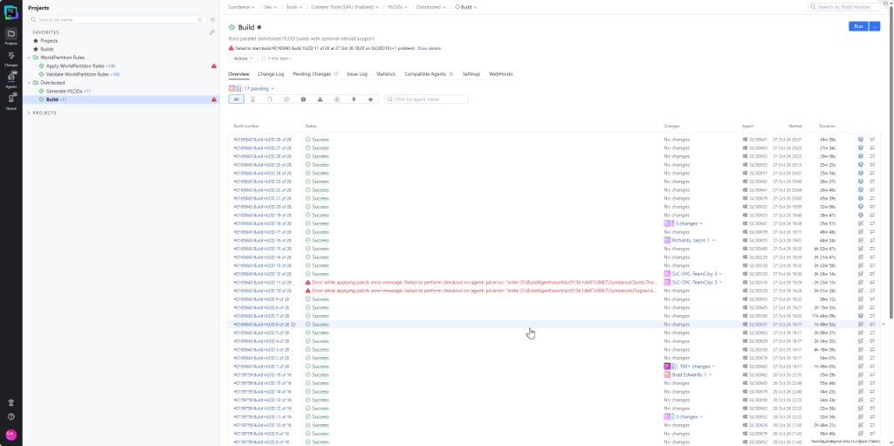
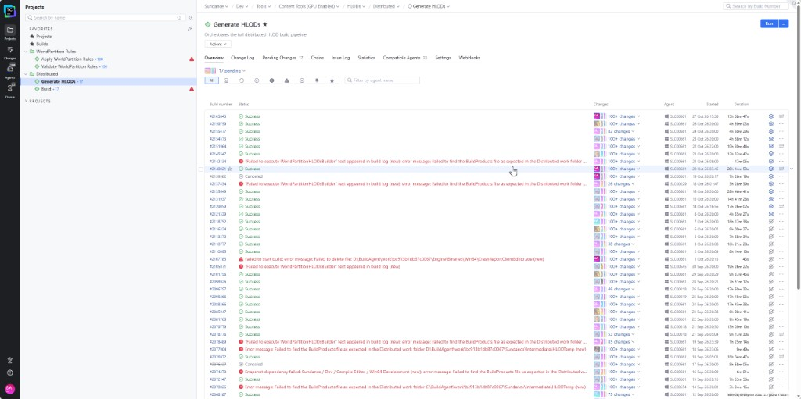

Parent: [Audits](README.md)

# Quidditch Pitch HLODs - rule assignment and regeneration (2026-10-28)

On October 28 Mark Lento reported that the **QuidditchPitch HLOD is missing in package
2168283**, and the editor showed `LI_QuidditchPitch` assigned to **Hogwarts Near** but apparently
absent from **Hogwarts Mid** and **Far**. Two questions followed: is a WorldPartition rule keeping
the pitch out of Mid / Far, and did the latest distributed HLOD build regenerate the pitch
correctly?

**The rules are not the cause.** `LI_QuidditchPitch` gets `LV_HW_HLODLayer_Near` from
`DA_HW_HLODLayer_Near_Rules`, its content inherits it, and Mid / Far are reached through the
`ParentLayer` chain, never through a rule. The pitch owns all 13 `LV_HW_*` HLOD actors of
`LV_Overland` - 7 Near, 3 Mid, 3 Far - and every one is submitted.

**The regeneration is incomplete.** The last distributed build (`#2165843`, submitted as
CL 2168270) rebuilt 5 of the 7 Near actors, which grew from ~170 KB to ~4 MB, but did **not**
rebuild Mid or Far. Those still date from CL 2160050 and therefore describe the *previous* Near
content. The package 2168283 contains the new Near and stale Mid / Far.

## Contents

- [TL;DR](#tldr)
- [How the pitch reaches each HLOD tier](#how-the-pitch-reaches-each-hlod-tier)
  - [Rule assignment](#rule-assignment)
  - [HLOD tiers of `HogwartsGrid`](#hlod-tiers-of-hogwartsgrid)
  - [The 13 HLOD actors of the pitch](#the-13-hlod-actors-of-the-pitch)
- [What the last HLOD build did](#what-the-last-hlod-build-did)
  - [Near rebuilt, Mid and Far untouched](#near-rebuilt-mid-and-far-untouched)
  - [Mid and Far trail Near by one build](#mid-and-far-trail-near-by-one-build)
  - [Why the engine should not allow that](#why-the-engine-should-not-allow-that)
  - [The two failed shards](#the-two-failed-shards)
- [What was checked and found clean](#what-was-checked-and-found-clean)
- [Open questions and recommendations](#open-questions-and-recommendations)
- [How this audit was run](#how-this-audit-was-run)

## TL;DR

| Question | Answer |
|---|---|
| Is a rule keeping the pitch out of Mid / Far? | No. Rules only assign Near; Mid and Far come from `LV_HW_HLODLayer_Near.ParentLayer = Mid` and `Mid.ParentLayer = Far` |
| Do Mid / Far HLOD actors exist for the pitch? | Yes - 3 Mid and 3 Far, all in `DL_QUIDDITCHPITCH` + `DL_OVERLAND`, all submitted |
| Was the pitch regenerated by build `#2165843` (CL 2168270, based on CL 2165781)? | **Near only.** 5 of 7 Near actors updated; 0 of 3 Mid and 0 of 3 Far |
| Are Mid / Far up to date? | **No.** Last real build CL 2160050 (based on CL 2159683); CL 2167621 is only a virtualization pass |
| Is this a one-off? | No. The same one-build lag shows on CL 2143656 and CL 2152929 |
| Did the two failed shards (10 and 11 of 28) cause it? | Unlikely for the pitch: a Near -> Mid -> Far chain is always dispatched to one workload, and its Near did build |
| Fix | One more HLOD build - nightly, or targeted with `-HLODLayer=LV_HW_HLODLayer_Mid` then `LV_HW_HLODLayer_Far` |

## How the pitch reaches each HLOD tier

### Rule assignment

`ExplainActorAssignment` on `LV_Overland/QuidditchPitch/LI_QuidditchPitch` (HLODLayer):

| Index | Rule | Verdict |
|---:|---|---|
| 0 | `DA_Overland_HLODLayer_NoneInclude_Rules` | Excluded by `TypesToExclude` entry `LevelInstance` |
| 2 | `DA_Overland_HLODLayer_Near_Rules` | Excluded by `OutlinerPathsToExclude` entry `LV_Overland/QuidditchPitch` |
| 7 | `DA_HW_HLODLayer_NoneInclude_Rules` | Excluded by `HLODLayerRulesToExclude` - the actor matches `DA_HW_HLODLayer_Near_Rules` |
| 8 | `DA_HW_HLODLayer_NoneExclude_Rules` | Excluded by `HLODLayerRulesToExclude` - same reason |
| **9** | **`DA_HW_HLODLayer_Near_Rules`** | **Match, condition 0 -> `LV_HW_HLODLayer_Near`. Current value equals expected value** |

The Hogwarts rules used by the pitch:

| Rule | Target | IncludeInHLOD | Conditions | Exclusions |
|---|---|---|---|---|
| `DA_HW_HLODLayer_Near_Rules` | `LV_HW_HLODLayer_Near` | true | `LevelInstance` **and** not inside a Level Instance, **and** one of: grid `HogwartsGrid` / path `LV_Overland/Hogwarts/LI_Hogwarts` / path `LV_Overland/QuidditchPitch` | paths `_INT`, `LI_WE`, `LI_DUN`, `Dungeon`, `Mission` |
| `DA_HW_HLODLayer_NoneInclude_Rules` | None | true | grid `HogwartsGrid` / path `LI_Hogwarts` / path `QuidditchPitch` | the Near rule, and the same 5 paths |
| `DA_HW_HLODLayer_NoneExclude_Rules` | None | false | same three conditions | the Near rule and the NoneInclude rule |

So the top-level `LI_QuidditchPitch` carries `LV_HW_HLODLayer_Near`, and its content carries
`None` with *Include in HLOD* set, which makes it inherit the Near layer of its Level Instance.
This is exactly the `LI_Hogwarts` pattern. No rule ever names Mid or Far.

### HLOD tiers of `HogwartsGrid`

From `GetHLODPartitionSetupAsMarkdown`:

| Tier | Cell size | Loading range | Min loading range | HLOD layers |
|---|---:|---:|---:|---|
| HogwartsGrid (main) | 12800 | 25600 | 6400 | - |
| HW_Near | 25600 | 51200 | 6400 | `LV_HW_HLODLayer_Near`, `LV_Overland_HLODLayer_Dummy` |
| HW_Mid | 51200 | 102400 | 12800 | `LV_HW_HLODLayer_Mid` |
| (non-spatially loaded) | 0 | 0 | 0 | `LV_HW_HLODLayer_Far` |

The layer chain is Near (Instancing) -> Mid (`MeshApproximateWithAutoInstancing`) -> Far
(`MeshApproximateWithAutoInstancing`, not spatially loaded). All three use `HLODSeasonModifier`.
`AuditHLODPartitionSetup` reports no finding on `HogwartsGrid`.

### The 13 HLOD actors of the pitch

These are every `LV_HW_*` HLOD actor in `LV_Overland`. All of them sit in
`DL_QUIDDITCHPITCH` + `DL_OVERLAND`. Package paths are relative to
`//sun/Dev/Sundance/Content/__ExternalActors__/Levels/Overland/LV_Overland/`.

| Layer | Actor | Package | Head | Last change |
|---|---|---|---:|---|
| Near | `HogwartsGrid_L0_X-5_Y-4_Z0` | `1/JU/2033X3PT1ZKSRABHBEFO73` | #20 | 2168270 |
| Near | `HogwartsGrid_L0_X-5_Y-3_Z0` | `2/9R/ZGM4ADDXMX7F6HF6PMXM5Q` | #20 | 2168270 |
| Near | `HogwartsGrid_L0_X-6_Y-4_Z0` | `2/AU/2D4NH5837R3Y0LB05UVO65` | #16 | 2168270 |
| Near | `HogwartsGrid_L0_X-5_Y-5_Z0` | `A/J3/JABXKS4I0U1W07W43TSWGU` | #2 | 2168270 |
| Near | `HogwartsGrid_L0_X-6_Y-3_Z0` | `D/PN/5PMF2TMQLR090QI8JNWB1E` | #14 | 2168270 |
| Near | `HogwartsGrid_L0_X-4_Y-3_Z0` | `7/LO/3EL5QILS3CIVTZR8P13W5Z` | #20 | 2160050 |
| Near | `HogwartsGrid_L0_X-4_Y-4_Z0` | `E/UO/B0JRCZX0LX49NPPETJWT2W` | #2 | 2160050 |
| Mid | `HW_Near_L0_X-3_Y-3_Z0` | `1/R2/FI2IK9KVX2FOLLSJTQ7LC7` | #2 | 2167621 (virtualization), built 2160050 |
| Mid | `HW_Near_L0_X-2_Y-2_Z0` | `4/5P/KZIVZZE1DS2NJCJ4VWD96U` | #26 | 2167621 (virtualization), built 2160050 |
| Mid | `HW_Near_L0_X-3_Y-2_Z0` | `9/R8/86S9YJQ7F3EXCENPBO2QII` | #24 | 2167621 (virtualization), built 2160050 |
| Far | `HW_Mid_L0_X-1_Y-1_Z0` | `1/70/NNYUDCSTI68L0XZTUO4QVI` | #26 | 2167621 (virtualization), built 2160050 |
| Far | `HW_Mid_L0_X-2_Y-2_Z0` | `6/G3/10JMD9878V3M52QEIHXAFZ` | #2 | 2167621 (virtualization), built 2160050 |
| Far | `HW_Mid_L0_X-2_Y-1_Z0` | `E/VX/7GF7PVDSK2PLZ2JGC2Q7SB` | #24 | 2167621 (virtualization), built 2160050 |

`CompareHLODLayers` on a workspace holding the CL 2160050 Near revisions reports the same
**438 input actors** (4.67M input triangles) on all three tiers. At that state Mid and Far did
match Near. The audit then found that head has moved Near on.

## What the last HLOD build did

*The 28 `Build HLOD` shards of distributed build `#2165843` (Oct 27). Shards 10 and 11 failed on
an agent-side p4 checkout; the other 26 succeeded.*

*`Generate HLODs` history. `#2165843` is reported Success (15h08m) and was submitted as
CL 2168270 - "Rebuilt HLODs for /Game/Levels/Overland/LV_Overland, Based on CL 2165781".*

### Near rebuilt, Mid and Far untouched

| Near package | Size at CL 2160050 | Size at CL 2168270 |
|---|---:|---:|
| `1/JU/2033X3PT1ZKSRABHBEFO73` | 169 783 | 4 047 984 |
| `2/9R/ZGM4ADDXMX7F6HF6PMXM5Q` | 463 226 | 4 772 440 |
| `2/AU/2D4NH5837R3Y0LB05UVO65` | 282 496 | 732 144 |
| `D/PN/5PMF2TMQLR090QI8JNWB1E` | 261 236 | 333 043 |
| `A/J3/JABXKS4I0U1W07W43TSWGU` | 22 150 | 22 150 (new digest) |

The Near content changed substantially. A Mid HLOD is approximated from the ISM components of
its Near children, so a change of this size should have produced new Mid and Far actors. None
was written.

### Mid and Far trail Near by one build

The size history of `1/JU/...` (Near) against `4/5P/...` (Mid) shows the same lag twice before:

| HLOD build CL | Near `1/JU` | Mid `4/5P` rebuilt? |
|---|---|---|
| 2137449 | rebuilt | yes |
| 2143656 | rebuilt, ~3.2 MB | **no** |
| 2146776 | rebuilt, ~3.2 MB | yes - catches up |
| 2152929 | rebuilt, drops to ~170 KB | **no** |
| 2154727 | unchanged | yes - catches up |
| 2160050 | rebuilt, ~170 KB | yes |
| 2168270 | rebuilt, jumps to ~4.0 MB | **no** |

Each Mid rebuild is followed by a TeamCity virtualization pass (`@AUTOMATION $VIRTUALIZATION`)
that shrinks the package from ~15 MB to ~50-90 KB. Those passes are not HLOD builds.

When Near changes, Mid and Far follow one build later. Unless the pattern breaks, the next HLOD
build should bring the pitch Mid / Far up to date.

### Why the engine should not allow that

Two facts from the engine say the lag should not happen within one build:

- `UWorldPartitionHLODsBuilder::GetHLODWorkloads` groups every HLOD actor with its children
  (`HLODParenting`, `RecursiveAdd`) and dispatches each group whole to one workload, children
  first. The 7 Near, 3 Mid and 3 Far of the pitch are always built on the same shard.
- A Mid hash is computed from its source components - the Near ISM components -
  and `UInstancedStaticMeshComponent::ComputeHLODHash` hashes `PerInstanceSMData`. New Near
  instances mean a new Mid hash and a Mid rebuild.

The cause of the lag is still open. Candidates are the AVA changes to the builder
(`AllowFailedWorkloadValidation`, the HLODTemp force-distribution, best-effort batch save), or
the Mid hash being evaluated against the Near descriptors on disk instead of the freshly built
ones. Confirming it needs the log of the shard that built the pitch.

### The two failed shards

Shards **10 and 11 of 28** of `#2165843` failed with *"Error while applying patch: Failed to
perform checkout on agent: p4 error: write: D:\BuildAgent\work\...\Sundance\..."*, so they never
ran. Every HLOD actor dispatched to them kept its previous revision. That does affect other
HLODs of `LV_Overland`, but it does not explain the pitch: the pitch group built its Near on a
successful shard, and its Mid / Far belong to the same group.

## What was checked and found clean

- **Rule assignment** of `LI_QuidditchPitch`: no mismatch, no ignore list or force exclusion
  involved (`ExplainActorAssignment`, `GetActorRuleFacts`: `HogwartsGrid`, spatially loaded,
  not inside a Level Instance, HLOD relevant).
- **Rule assets** `DA_HW_HLODLayer_Near_Rules`, `_NoneInclude_Rules`, `_NoneExclude_Rules`: the
  pitch is handled with the same conditions as `LI_Hogwarts`.
- **Layer chain**: Near -> Mid -> Far `ParentLayer` links are set.
- **Partition setup**: all three HW layers are assigned to a tier of `HogwartsGrid`. The audit
  only reports derived-default drift on other grids.
- **Perforce**: all 13 pitch HLOD packages are submitted; none is opened or missing in the depot.
  CL 2168270 predates the package 2168283, so the package does carry the new Near.

## Open questions and recommendations

- **Rebuild Mid and Far** for `LV_Overland`, or wait for the next nightly and check that
  `1/R2`, `4/5P`, `9/R8`, `1/70`, `6/G3` and `E/VX` get a new `$OVERLAND` revision.
- **Find the cause of the one-build lag**: pull the `#2165843` shard log that holds
  `LV_HW_HLODLayer_Mid/HW_Near_L0_X-2_Y-2_Z0` and check whether the Mid hash was computed and
  compared before or after its Near children were rebuilt.
- **Explain the Near oscillation** (~50 KB -> ~3.2 MB -> ~170 KB -> ~4 MB across a month): the
  pitch Near inputs change a lot from build to build, which is worth tracing back to the source
  changelists.
- **"Missing in package 2168283"**: with Near rebuilt and Mid / Far stale but present, a
  complete absence at runtime points to streaming (is `DL_QUIDDITCHPITCH` activated?) or cook,
  not to the HLOD data.
- A local workspace behind head on the Near packages (#19 instead of #20) shows Near and Mid
  consistent and hides the problem. Read the depot, not the editor, when checking a build.

## How this audit was run

- Unreal Editor (DebugGame) with `LV_Overland` open and `LI_QuidditchPitch` loaded, driven over
  the Unreal MCP server (`http://127.0.0.1:8000/mcp`) with
  [`mcp_batch.py`](scripts/QuidditchPitchHLODRegeneration-2026-10-28/mcp_batch.py) and
  [`hlod_quidditch_calls1.json`](scripts/QuidditchPitchHLODRegeneration-2026-10-28/hlod_quidditch_calls1.json):
  - `HLODPartitionConfigToolset`: `GetHLODPartitionSetupAsMarkdown`, `AuditHLODPartitionSetup`
  - `WorldPartitionRuleAuditToolset`: `ExplainActorAssignment`, `GetActorRuleFacts`
  - `HLODStatsToolset`: `CompareHLODLayers` on `HW_Near`, `HW_Mid`, `HW_Far`
- Editor Python through `PythonScriptingTools.execute_python`
  ([`mcp_run_editor_py.py`](scripts/QuidditchPitchHLODRegeneration-2026-10-28/mcp_run_editor_py.py)):
  - [`hlod_quidditch_dump_layers.py`](scripts/QuidditchPitchHLODRegeneration-2026-10-28/hlod_quidditch_dump_layers.py)
    dumps the Hogwarts HLOD layers and rule assets.
  - [`hlod_quidditch_descs.py`](scripts/QuidditchPitchHLODRegeneration-2026-10-28/hlod_quidditch_descs.py)
    lists the `LV_HW_*` HLOD actor descriptors with grid, data layers, bounds and package.
- Perforce, read-only: `p4 fstat`, `p4 fstat -Ol -Of` (size history), `p4 filelog`,
  `p4 describe -s` on CLs 2160050, 2167621 and 2168270.
- Engine source: `WorldPartitionHLODsBuilder.cpp` (`GetHLODWorkloads`),
  `HLODSourceActorsFromCell.cpp` and `InstancedStaticMesh.cpp` (`ComputeHLODHash`).
- TeamCity screenshots of `Generate HLODs` and `Build` `#2165843`, Oct 28 2026.
