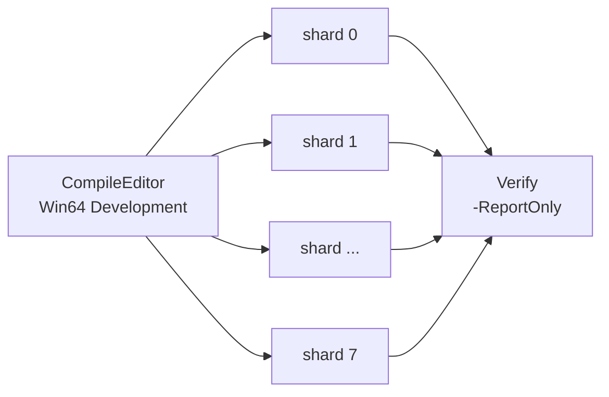

Parent: [Reference Docs](README.md)

# Development Plan — Parallel processing for `WorldPartitionRuleBuilder`

*Splitting the nightly [Apply World Partition Rules](TeamCityJobs.md#apply-world-partition-rules)
run across several TeamCity agents — each one processing a disjoint set of cells — to bring the
10-hour `LV_Overland` pass into a 2-3 hour window.*

Status: **proposal**, nothing implemented yet. Written 2026-10-21, from the measurements of the
2026-10-20 `-ReportOnly` run and the TeamCity build history of
[`Sundance_Dev_Tools_ApplyWorldPartitionRules`](https://slc-teamcity.wbiegames.com/buildConfiguration/Sundance_Dev_Tools_ApplyWorldPartitionRules#all-projects).

## Contents

- [The problem](#the-problem)
- [Where the time goes](#where-the-time-goes)
- [Why the current split is maxed out](#why-the-current-split-is-maxed-out)
- [Cell vs Shard](#cell-vs-shard)
  - [What a shard is](#what-a-shard-is)
  - [Why cells are not handed out in contiguous blocks](#why-cells-are-not-handed-out-in-contiguous-blocks)
  - [How an actor is assigned](#how-an-actor-is-assigned)
- [Why not change `GetLoadingMode()`](#why-not-change-getloadingmode)
- [Exposed parameters](#exposed-parameters)
- [How it runs on TeamCity](#how-it-runs-on-teamcity)
  - [Today](#today)
  - [Proposed — the Matrix Build](#proposed--the-matrix-build)
  - [The verification step](#the-verification-step)
  - [The hard constraint — agents](#the-hard-constraint--agents)
- [What we can expect](#what-we-can-expect)
- [Risks and how each is closed](#risks-and-how-each-is-closed)
  - [How we prove it before trusting it](#how-we-prove-it-before-trusting-it)
- [Phasing](#phasing)
- [Open questions](#open-questions)
- [See also](#see-also)

---

## The problem

Applying World Partition rules to `LV_Overland` takes about **10 hours** of wall clock on a single
TeamCity agent. The [validation build](TeamCityJobs.md#the-validation-build) on the same level takes
**18 hours to 2.5 days**. Both run in the nightly window, and both are now the long pole: a rule
authoring change cannot be verified the same day.

This document proposes splitting that single run across several agents, with a design that
guarantees no actor is processed twice and none is missed.

## Where the time goes

Measured on the latest `-ReportOnly` run of `LV_Overland` (2026-10-20,
`Saved/Logs/WorldPartition/WorldPartitionRulesReport-LV_Overland.json`):

| Metric | Value |
|--------|-------|
| Actor descriptors walked | 622 307 |
| Rule mismatches found | 62 625 |
| Unique actors needing a write | 57 273 |

[`UWorldPartitionRuleBuilder`](BuildersAndCommandlets.md#uworldpartitionrulebuilder) does four
things, in order:

1. Walk all 622 307 actor descriptors.
2. For each, evaluate the rules **from the descriptor alone** — no asset is loaded.
   This is `ShouldProcessActor`, wired in as `FForEachActorWithLoadingParams::FilterActorDescInstance`.
3. Load only the ~57 000 actors that disagree with the rules.
4. Check out, modify and save their packages through Perforce (`OnProcessActor` →
   `SaveModifiedPackages`).

Ten hours over 57 000 written actors is roughly **0.6 s per actor**, and steps 3 and 4 own almost
all of it. That work is embarrassingly parallel: each actor is an independent package, and there is
no ordering dependency between them.

Three costs do **not** shard, and they set the floor on any speedup:

- agent setup (`p4 clean` / `p4 reconcile` over `__ExternalActors__/...`, editor binary pull);
- world initialization, asset registry scan, and the full streaming generation performed by
  `GatherHLODLayerGridMismatches`;
- the descriptor walk itself.

**Measuring these three is the first task of the project**, because they decide whether 8 agents are
worth it or whether 4 already saturate the gain.

## Why the current split is maxed out

The build is *already* split, by outliner path: separate runs for `Missions`, `Dungeons`,
`LI_Hogwarts`, `LI_Hogsmeade`, and one catch-all run with no filter — the
`-ContainOutlinerPathSubstrings` / `-DiscardOutlinerPathSubstrings` parameters described in
[TeamCity jobs](TeamCityJobs.md#parameters). That axis is exhausted.

Grouping the 57 273 actors that need a write by outliner path prefix, and packing those groups into
shards as evenly as possible:

| Shards | Best achievable speedup (depth-2 prefixes) | Best achievable speedup (depth-3 prefixes) |
|--------|--------------------------------------------|--------------------------------------------|
| 4 | 3.1x | 4.0x |
| 8 | 3.1x | 6.8x |
| 16 | 3.1x | 6.8x |
| 32 | 3.1x | 6.8x |

The curve goes flat because two groups dominate and cannot be subdivided by path:
`Region/Hogwarts Valley` holds 18 501 actors (32 % of the total) and
`Region/Coast/Stronghold_Brathborne` holds 8 463 (15 %). The heaviest single group sets the wall
clock no matter how many agents we add.

**The conclusion that drives the whole design: the split has to cut *inside* a region.**

## Cell vs Shard

These are two different levels, and conflating them is the easiest way to get a disappointing
result.

| | What it is | How many |
|---|------------|----------|
| **Cell** | the unit of geographic subdivision — a square of the map | a few hundred (1 km grid over the Overland) |
| **Shard** | a batch of cells handed to one agent | 8 |

### What a shard is

A shard is **a slice of the total work, plus the process that executes it**.

Today, one `UnrealEditor-Cmd.exe` opens `LV_Overland`, walks 622 307 descriptors and processes all
57 000 actors that need a write. With 8 shards we launch **the same process 8 times, on the same
level, with the same command line**, except for one parameter that tells each one "you are number 3
of 8". Each still walks all 622 307 descriptors, but each only processes the ~7 000 actors it owns.

The important property: **there is no coordinator, no work queue, and no communication between
shards**. Every process independently computes, for each actor, which shard owns it. Because that
computation is purely deterministic, the eight answers fit together with no overlap and no gap.

The analogy: eight people each receive the same complete phone book and the instruction "handle
only the names whose hash lands on your number". None of them talks to the others, and yet the book
is covered exactly once. That only holds if everyone has **the same book** (the same Perforce
changelist, which a TeamCity snapshot dependency guarantees) and **the same rule** (a grid anchored
at the world origin with a fixed cell size, never derived from `UWorldPartition::GetEditorWorldBounds()`,
which would differ between machines).

### Why cells are not handed out in contiguous blocks

We do **not** do "1 cell = 1 shard". We subdivide finely, then distribute cells to shards by hash,
interleaved: shard 3 gets one cell in Hogwarts Valley, one on the Coast, one in the Mountain, and so
on.

This is exactly what fixes the imbalance measured above. With 16 contiguous cells, the one containing
Hogwarts Valley would carry 32 % of the work on its own and would dictate the wall clock of the
entire build — reproducing the flat curve we are trying to escape.

### How an actor is assigned

From `FWorldPartitionActorDescInstance` only, before anything is loaded:

1. Take `GetEditorBounds()`.
2. Use the **centre**, never the overlap. An actor straddling a cell edge must belong to exactly one
   cell, otherwise two agents end up fighting over the same `.uasset`.
3. Hash the cell coordinate, modulo the shard count.
4. Actors with invalid bounds, or with `GetIsSpatiallyLoaded() == false`, have no meaningful cell:
   spread them by `GetTypeHash(Guid)`, so each still lands in exactly one shard.

The test goes **first** in `ShouldProcessActor`, before the class filter and before any rule
evaluation, so a foreign actor never pays for an outliner path resolve. That is what makes the
descriptor walk shard too, rather than staying a fixed serial cost.

## Why not change `GetLoadingMode()`

`UWorldPartitionRuleBuilder::GetLoadingMode()` returns `ELoadingMode::Custom`. That means
`UWorldPartitionBuilder::Run` calls `RunInternal` once with nothing loaded, and the builder drives
its own loading through `FWorldPartitionHelpers::ForEachActorWithLoading`.

That is precisely what makes it fast for its workload: the filter callback answers from the
descriptor, so **only the ~57 000 actors that need a change are ever loaded** — not the 622 307.

Switching to `ELoadingMode::IterativeCells2D` would hand loading back to the engine, which loads
*every* actor in the cell region through an `FLoaderAdapterShape` before `RunInternal` sees it. That
is exactly the cost profile of [`-ValidateOnly`](ReportOnlyVsValidateOnly.md), which loads
everything — and which takes 18 hours to 2.5 days instead of 10. It would make the builder two to
four times slower before any sharding gain is counted.

The World Building Pipeline (`UAvaWorldPartitionBuilder`, in the `AvaWorldPipeline` plugin) does use
`IterativeCells2D`, and correctly so: PCG regeneration genuinely needs the region resident in
memory. Our builder does not.

**We take the Pipeline's sharding design, not its loading mode.** Its `-SplitWorld` /
`-SplitWorldStartAt` parameters are already proven in production on the same build farm, so reusing
the names means the existing TeamCity knowledge and runbooks transfer unchanged.

## Exposed parameters

Three new commandlet switches on `WorldPartitionRuleBuilder`:

| Parameter | Default | Meaning |
|-----------|---------|---------|
| `-SplitWorld=N` | `1` | Number of shards. `1` is today's behaviour, bit for bit. |
| `-SplitWorldStartAt=I` | `0` | Which shard this process is, 0-based. |
| `-ShardCellSize=<cm>` | `102400` | Edge of the square XY cell. Fixed grid, anchored at the world origin. |

Plus one developer-facing switch, not used by CI:

| Parameter | Meaning |
|-----------|---------|
| `-CellCoord=X,Y` | Process only the single cell at that grid coordinate — "just redo this area". |

And two matching TeamCity parameters, alongside the existing `wp-rules.*` set:

| Parameter | Default |
|-----------|---------|
| `wp-rules.split_count` | `1` |
| `wp-rules.split_index` | `0` |

Because the defaults reproduce today's behaviour exactly, **the code and the TeamCity parameters can
ship and bake in production for a week before any fan-out is switched on**.

Code footprint: roughly 150 lines across `WorldPartitionRuleBuilder.h` / `.cpp`. Nothing in the
engine, no new module, no asset change.

## How it runs on TeamCity

The server is on **TeamCity 2024.12.3**, so the built-in **Matrix Build** feature is available.

### Today

One build configuration, one build, one agent, seven steps (InstaLOD licence, editor binary pull,
Perforce cleanup, the commandlet, revert unchanged, submit, cleanup on failure). About 10 hours.
See [TeamCity jobs](TeamCityJobs.md#the-command-line-behind-the-job) for the current command line.

### Proposed — the Matrix Build

We keep **the same build configuration** and add the Matrix Build feature to it, with one dimension
`wp-rules.split_index` taking the values `0..7`. TeamCity then creates the eight parallel builds
automatically, plus a composite head that aggregates them and carries the overall status.

Each shard build is a full, independent TeamCity build:

- it runs on **its own agent**, with its own checkout directory and its own Perforce workspace
  (`env.P4CLIENT` is already per-agent);
- it executes the **same seven steps** as today, unchanged;
- the `Apply WorldPartition Rules` step simply gains `-SplitWorld=8 -SplitWorldStartAt=<index>`;
- the `Submit Files` step creates **its own changelist**, containing only its ~7 000 actors. The
  actor sets are disjoint, so the eight concurrent submits do not collide.

All shards take a snapshot dependency on the same `Sundance_Dev_CompileEditor_Win64Development`
build. That is what pins every shard to a single Perforce revision — the "same phone book"
requirement above.

### The verification step

A `..._Verify` configuration depends on all shards and re-runs the commandlet with
[`-ReportOnly`](ReportOnlyVsValidateOnly.md) over the whole level, unsharded. It is cheap, because
`-ReportOnly` never loads an actor, and it is the real guarantee that the parallel run produced the
same result as a serial one. It publishes the JSON report as an artifact and emits the finding count
as a TeamCity statistic, so a regression shows up on the trend graph rather than in someone's inbox
three weeks later.

It should fail above a tolerance rather than at a hard zero: the report deliberately includes actors
whose package cannot be checked out, and `MatchButRuleAssetMissing` entries.

### The hard constraint — agents

The configuration currently has **13 compatible agents** (`SLC-BL004`–`SLC-BL014`, `SLC-BL058`–
`SLC-BL060`). A 10-hour run split 8 ways still occupies 8 of those 13 for about 2 hours, and the
`Missions` / `Dungeons` / `LI_Hogwarts` / `LI_Hogsmeade` jobs share the same nightly window.

**N = 8 is the realistic target. N = 16 is physically impossible without growing the pool.**

## What we can expect

The achievable speedup is `T(N) = T_fixed + T_work / N`, where `T_fixed` is the non-shardable cost.
That value is not yet measured, so here are the three plausible scenarios against today's 10 hours:

| `T_fixed` | 4 shards | 8 shards | 13 shards |
|-----------|----------|----------|-----------|
| 30 min | 2 h 55 (3.5x) | 1 h 40 (5.9x) | 1 h 15 (8.1x) |
| 1 h | 3 h 15 (3.1x) | 2 h 05 (4.7x) | 1 h 40 (5.9x) |
| 2 h | 4 h 00 (2.5x) | 3 h 00 (3.3x) | 2 h 40 (3.8x) |

**Target: 8 shards, bringing the 10-hour run into a 2-3 hour window.** Going beyond that is worth it
only if the measurement shows a small fixed cost, and only if the agent pool grows.

The fixed cost is itself attackable: the Perforce cleanup runs over the whole `__ExternalActors__`
tree on every shard, and the streaming generation in `GatherHLODLayerGridMismatches` only produces
warnings, so it could run on shard 0 alone.

## Risks and how each is closed

| Risk | What it would cost us | Mitigation |
|------|----------------------|------------|
| An actor claimed by two shards | Two agents check out the same `.uasset`. With an exclusive lock the second silently fails `CanCheckoutPackage` and **skips the actor** — green build, non-compliant level. | Centre-based cell ownership; no overlap by construction, verified by an automated test. |
| An actor claimed by no shard | Silently non-compliant. | The assignment is a total function of the descriptor; completeness is verified by the same test. |
| Shards computing different grids | Gaps and overlaps. | Fixed origin and fixed cell size; the grid never reads the world's current bounds. |
| Shards on different changelists | Same. | Snapshot dependency pins one revision for the whole fan-out. |
| Level Instance placements split across shards | `HandleLevelInstanceRecursive` writes the *inner level asset's* packages, which every placement shares — two agents would write the same files. | Level Instances are sharded by their **container package** (`UActorDescContainerInstance::GetContainerPackage()`), so every placement of one asset lands on the same agent. |
| `LV_Overland.umap` and the `AWorldDataLayers` package | One package, eight agents. `FinalizeRunInternal` saves both when dirty, and with `-DataLayerRules` any shard can create a missing `UDataLayerInstance`. | Only shard 0 may write them; another shard that still needs a change fails loudly instead of dropping it. |
| One shard fails | Level half-applied. | The composite fails if any shard fails; the existing revert and cleanup steps already run with `execute_always`. |

### How we prove it before trusting it

The strongest test costs almost nothing and needs no agents: run `-ReportOnly -SplitWorld=4` for
indices 0 to 3, plus one unsharded reference run, all on the same changelist. A script then asserts
that the union of the four actor sets equals the reference set, and that all pairwise intersections
are empty. No asset is loaded, nothing is written, and it directly validates the only property the
whole design rests on. Cheap enough to keep as a recurring CI check.

## Phasing

| Phase | Work | Estimate |
|-------|------|----------|
| 0 | Measure the fixed vs shardable cost; confirm agent availability in the nightly window. Choose N from real numbers. | 0.5–1 d |
| 1 | Implement the three parameters, Level Instance container sharding, shared-package guard. | 2–3 d |
| 2 | Disjointness / completeness test; per-shard census in the report. | 1 d |
| 3 | TeamCity parameters (dark launch at `split_count=1`), Matrix Build fan-out, verify configuration. | 1–2 d |
| 4 | Ramp N up, tune the cell size, update the runbook. | 1 d |

About **6 to 8 working days**, with a usable intermediate state after phase 1.

## Open questions

1. **Level Instance placement deduplication.** Today the same Level Instance asset placed *k* times
   has its inner actors processed *k* times, writing the same packages each time. Deduplicating
   would be a large win on the `LI_Hogwarts` / `LI_Hogsmeade` / `Dungeons` runs — but rule matching
   uses the full outliner path, which differs per placement, so two placements can legitimately
   resolve to different values for the same inner actor. That is arguably already a latent bug (last
   writer wins). This needs a ruling before anyone touches it.
2. **Should the [validation build](TeamCityJobs.md#the-validation-build) be the first target
   instead?** It is the longest job on the board at 18 hours to 2.5 days, it loads every actor, and
   it **writes nothing** — so it shards with none of the Perforce hazards above. It may be both the
   easier and the more valuable first win.
3. **Do we want to grow the agent pool?** Thirteen compatible agents caps the design at roughly 6x.
   Whether that is worth revisiting depends on how the nightly window is budgeted overall.

## See also

- [TeamCity jobs](TeamCityJobs.md) — the current Apply and Validate build configurations, their
  parameters, schedule and outputs.
- [`-ReportOnly` vs `-ValidateOnly`](ReportOnlyVsValidateOnly.md) — the two read-only modes this plan
  leans on for both measurement and verification.
- [Builders & commandlets](BuildersAndCommandlets.md#uworldpartitionrulebuilder) — the builder being
  modified, with line-level code.
- [World Partition builders catalog](WorldPartitionBuildersCatalog.md) — every WP builder and its
  switches, including the World Building Pipeline builder this design borrows from.
