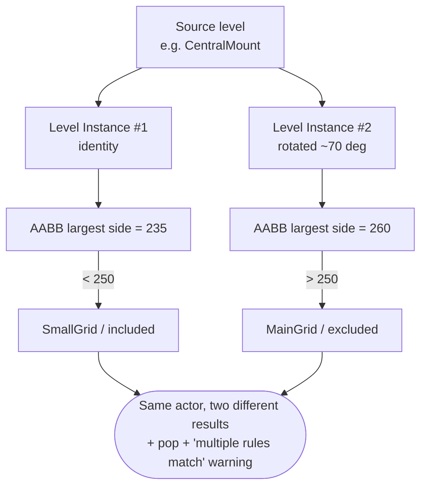
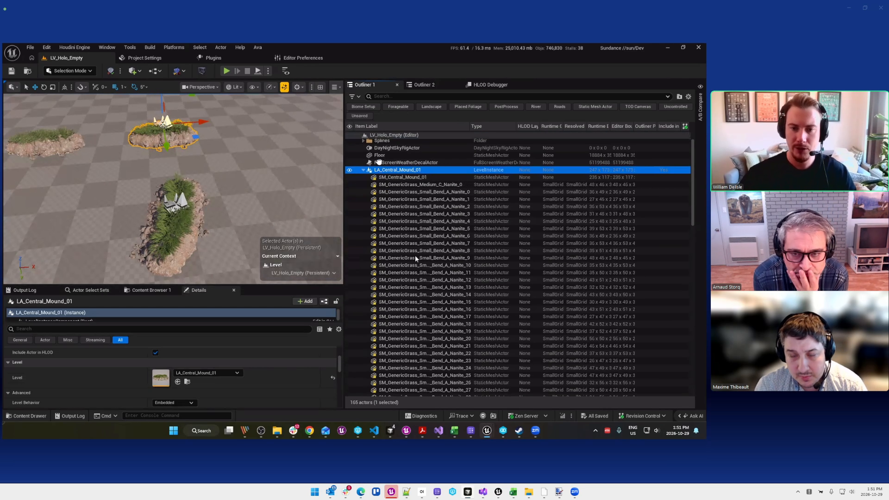
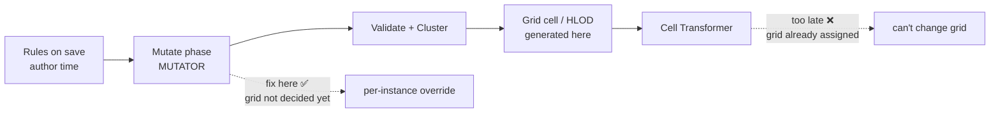
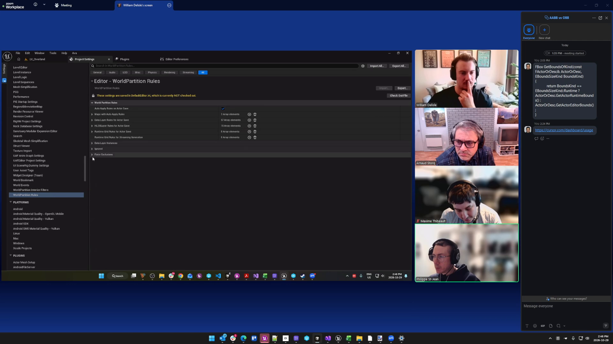
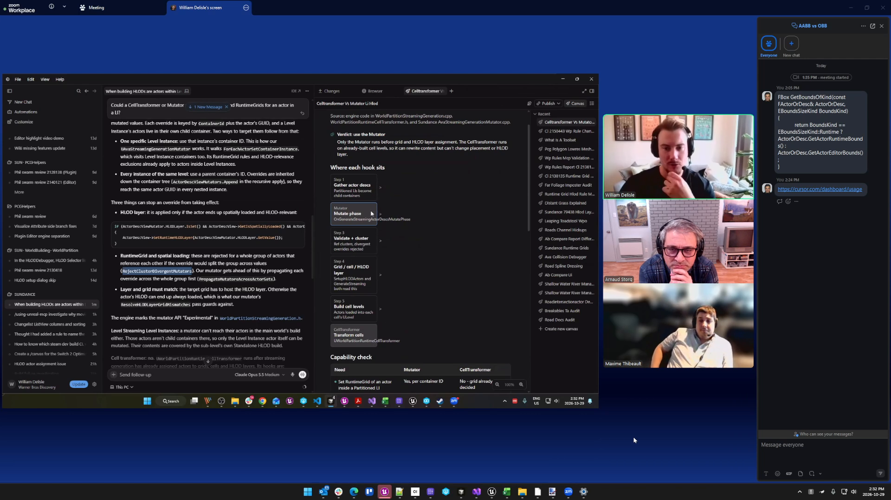
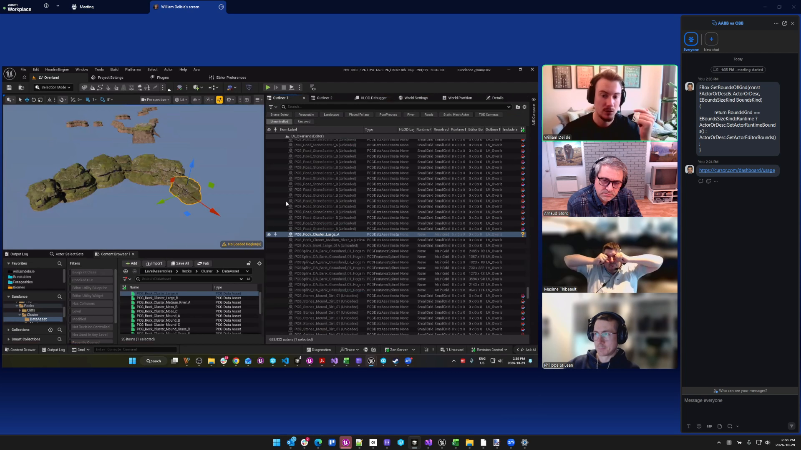

# Sync with William, Phil & Max — 2026-10-29 — Rotation/scale break grid & HLOD assignment

- **Source**: `C:\Users\Arnaud.Storq\Videos\WilliamPhilMax_Mutator_.mp4` (`1:24:17`, French, English terms)
- **Participants**: Arnaud, **William Delisle** (screen-share), **Maxime Thibeault** ("Max") and
  **Philippe St-Jean** ("Phil", joins ~`49:30`, leaves ~`1:18:55`) — the World Partition engine experts.
- **Transcription**: auto-generated (faster-whisper `large-v3`, GPU), no speaker diarization.
  Verbatim: [`_verbatim.txt`](SyncWithWilliamPhilMax_2026-10-29_ActorBoundsMutator_verbatim.txt) ·
  subtitles: [`.srt`](SyncWithWilliamPhilMax_2026-10-29_ActorBoundsMutator.srt)

## Contents

- [TL;DR](#tldr)
- [The problem](#the-problem)
- [Why the sphere radius isn't enough](#why-the-sphere-radius-isnt-enough)
- [Where to fix it: the Mutator, not the Cell Transformer](#where-to-fix-it-the-mutator-not-the-cell-transformer)
- [The long-term fix: PCG Data Asset Instances](#the-long-term-fix-pcg-data-asset-instances)
- [Decisions](#decisions)
- [Action items](#action-items)
- [See also](#see-also)

---

## TL;DR

The same source level, placed twice with **different rotation/scale**, gets **different bounds**, so the
same actor can land in a **different RuntimeGrid / HLOD layer** — non-deterministic, causes popping. The
agreed fix: stop trying to solve it in the author-time rules and instead **correct it late, in a Mutator**
(the infra already exists). Long term: **convert scaled "dressing" Level Instances to PCG Data Asset
Instances** and lock Level-Instance scale to `1-1-1`.

---

## The problem

One source level, two Level Instances — one rotated. The rules read the **axis-aligned bounding box
(AABB)**, which changes with rotation, so the two copies measure differently (e.g. largest side **235** vs
**260**). Around a size threshold (~**250**), one copy is **included** and the other **excluded** → same
mesh, two different grids/HLOD tiers.

## Why the sphere radius isn't enough

Max's idea: measure the **bounding sphere radius** instead of the AABB — a sphere is the same whatever the
rotation. True, but it **does not fix scale**: an instance at `1×` vs `3×` still measures differently. And
because the rule writes the grid on the **shared source actor**, the result also **depends on processing
order** (and breaks further if the pass only runs a subset of the world).

| Metric | Rotation-proof? | Scale-proof? |
|---|---|---|
| AABB (today) | ❌ | ❌ |
| Bounding sphere radius | ✅ | ❌ |

## Where to fix it: the Mutator, not the Cell Transformer

At **cook** time the Level Instances are embedded, so each copy becomes an **individual** actor you can
set per-instance. The streaming-generation pipeline gives two late hooks — but only one is early enough:

Key points:
- The **Mutator** runs *before* grids are built → right place to override grid/HLOD per instance.
- The **Cell Transformer** runs *after* → too late for grid.
- They **already** ship RuntimeGrid mutators (used to patch cook discrepancies); overriding the **HLOD
  layer** in a mutator became possible in **UE 5.8**, so an HLOD mutator can follow the same pattern.
- It's **cheap** — the mutator reassigns already-loaded actors (SmallGrid used to live here, ~10–15 s in
  PIE); the 5–6 h cost today is the open/save of the author-time pass, not the assignment.
- To target a specific instance, reuse Phil's **Outliner Path Registry** (a hash of the parent-container
  GUIDs → a unique path per instance), built over the **full** world (never from subsets).

> Pipeline phases and the "where can each hook act" check, as read on the call:
>
> 

## The long-term fix: PCG Data Asset Instances

The root cause is using **scaled Level Instances for dressing**. The durable answer is to replace them
with **PCG Data Asset Instances** ("PCG Assembly"): on **Build PCG / Biome Core** the editor-only preview
is dumped into the **PCG partition** as an **ISMC**, already handled by the streaming grid and HLOD — so
these can be scaled/rotated freely. Everything else keeps **scale locked to `1-1-1`** (as on *Mercury*).
Dan may already have started this. Phil's caution: first **count how many actors are actually impacted** —
if it's a handful, it's not worth the heavy machinery.

---

## Decisions

| # | Decision |
|---|---|
| 1 | Fix the per-instance size discrepancies in a **Mutator** (Mutate phase), scoped to Level-Instance actors — not in a Cell Transformer (too late), not on save. |
| 2 | Reuse the existing RuntimeGrid mutator; add an **HLOD-layer mutator** (possible since **UE 5.8**). |
| 3 | Make it **data-driven** where possible: split `SmallGrid` into on-save **Hogwarts Interior** + mutator-fixed **Overland small objects**. |
| 4 | Identify duplicated instances via an **Outliner Path Registry** (hash of parent GUIDs), built over the **whole** world. |
| 5 | Long term: **PCG Data Asset Instances** for scaled dressing + **lock Level-Instance scale to `1-1-1`**. |
| 6 | Before any heavy build, **assess the real impact** and **re-validate the plan with Phil**. |

## Action items

| Owner | Item |
|---|---|
| Arnaud | Count unique source level → multiple Level-Instance actors with different scale/rotation in Overland (scope). |
| Arnaud | Ramp up on Mutators; add a "resolved/final RuntimeGrid" preview column to the review tool. |
| William | Prototype the mutator / data-driven rule split. |
| Team | Write the plan and re-challenge it with Phil before the rewrite. |
| Team | Investigate scaled dressing Level Instances → **PCG Data Asset Instances** (what did Dan start?) + lock scale to `1-1-1`. |
| Team | **Benchmark** merging `SmallGrid` (Overland) into `MainGrid`. |

---

## See also

- [HLOD layer ↔ RuntimeGrid hosting warnings](Audits/HLODLayerRuntimeGridHosting-2026-10-19.md)
- [Rule engine mechanics](ReferenceDocs/WorldPartitionRulesAnalysis/RuleEngineMechanics.md)
- [Runtime Grid rules](ReferenceDocs/WorldPartitionRulesAnalysis/RuntimeGridRules.md)
- [Sync with Phil & William — 2026-10-19 — MainGrid rules, Quidditch Pitch, HLOD instancing](SyncWithPhilWilliam_2026-10-19_QuidditchRuntimeGridRules_transcript.md)
- [Transcription & research](ReferenceDocs/TranscriptionAndResearch.md)
